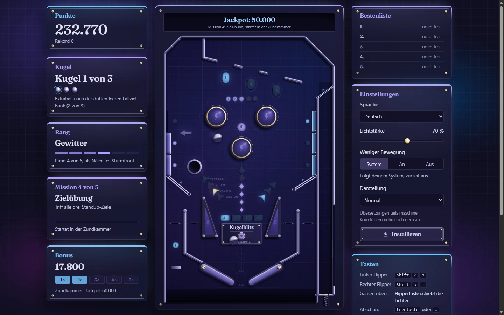
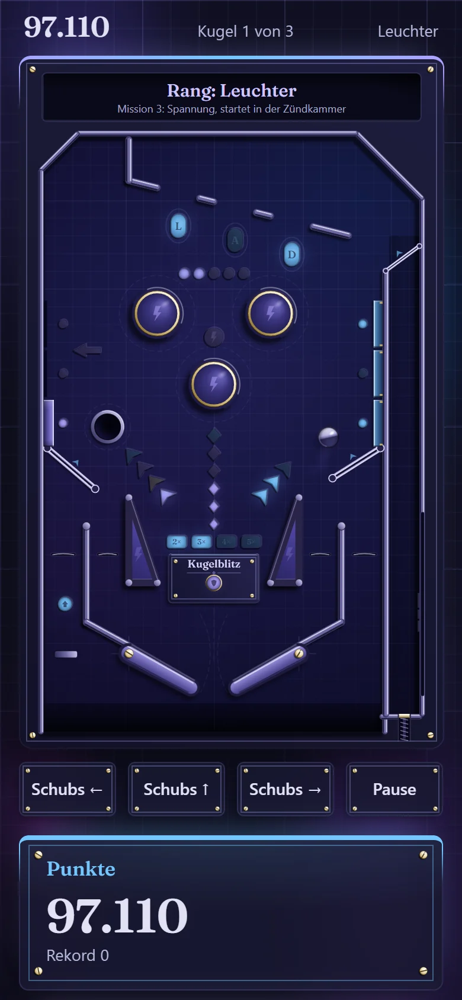
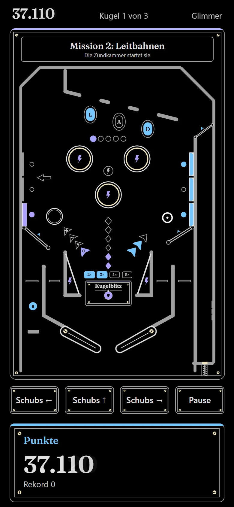

# Kugelblitz

**Ein Flipper im Browser, dunkel, ohne Ton und ohne einen einzigen Blitz.** Fünf Missionen, sechs Ränge, ein Multiball mit Jackpots und eine Bestenliste, auf einer Physik, durch die keine Kugel rutscht. Am Rechner mit Tasten, am Handy oder Tablet mit den Fingern. Läuft direkt auf der Seite, lässt sich als App installieren und geht nach dem ersten Besuch auch offline.

  

**Spielen:** https://dennismit2n.github.io/kugelblitz/ · [English version](README.md)

## Der Tisch

Ein ganzer Tisch auf einem Bildschirm: Abschussrampe mit Skill Shot, zwei Flipper, zwei Schleudern, In- und Outlanes mit Kickback links, die drei Gassen L, A und D oben, drei Bumper, eine Fallziel-Bank links, drei Standup-Ziele rechts und die Zündkammer, ein Loch in der Mitte, das die Kugel eine Sekunde hält und dann startet, was gerade leuchtet. Gezeichnet im Stil meiner Werkstatt: violette Nacht, Aurora, Bauplan-Raster und Platten mit Schrauben in Weißgold.

## Tasten und Finger

| | Tastatur | Finger |
|---|---|---|
| **Flipper** | Shift links und rechts, ← →, oder `Y` und `-` (auf einer englischen Tastatur `Z` und `/`) | linke oder rechte Tischhälfte antippen |
| **Abschuss** | Leertaste oder ↓ halten, loslassen | Rampe halten oder nach unten ziehen |
| **Schubsen** | X, Punkt, ↑ | Knöpfe unter dem Tisch |
| **Pause** | P oder Esc | Knopf unter dem Tisch |
| **Neues Spiel** | F2 jederzeit, Enter vor und nach einem Spiel | auf den Tisch tippen |
| **Vorführung der Physik** | T wechselt die Schrittweite, B schießt eine Probesalve | nur mit Tasten |

Das Spiel zeigt die Beschriftung deiner eigenen Tastatur an. Enter zählt außerdem den Bonus sofort zu Ende.

## Spielregeln kurz

- **Drei Kugeln, fünf Missionen.** Sie kommen nacheinander über das ganze Spiel, ohne Zeitgrenze: *Ladung sammeln* (triff die Bumper 15 Mal), *Leitbahnen* (schalte alle drei Gassen oben), *Spannung* (leere die Fallziel-Bank zweimal), *Zielübung* (triff alle drei Standup-Ziele) und *Entladung* (schick die Kugel dreimal in die Zündkammer). Die erste startet mit dem ersten Abschuss, jede weitere in der Zündkammer.
- **Sechs Ränge.** Jede Mission bringt dich einen Rang höher: Funke, Glimmer, Leuchter, Gewitter, Sturmfront und zuletzt Kugelblitz. Eine Mission bringt 25.000 Punkte mal die Nummer deines Rangs.
- **Multiball „Gewittersturm“.** Ab Rang Gewitter zündet die Zündkammer den Sturm. Eine zweite Kugel kommt dazu, und jeder Besuch in der Zündkammer bringt den Jackpot: 50.000, danach jedes Mal 10.000 mehr.
- **Und der Rest eines echten Tisches:** Skill Shot auf die markierte Gasse (10.000), Bonus-Multiplikator bis 5× über die Gassen oben (die Flippertasten schieben die Lichter), Kickback, Ballschutz für 8 Sekunden nach jedem Abschuss (im Multiball 12), Tilt mit Warnung vorher, Extraball nach der dritten geleerten Fallziel-Bank und eine Bestenliste der besten fünf mit Datum.

## Die Physik: nichts tunnelt durch

Kugelblitz läuft auf einer eigenen kleinen Physik, entstanden aus Lektion 04 von Matthias Müllers „Ten Minute Physics“. Die Lektion bewegt jede Kugel einmal je Bild. Eine schnelle Kugel springt dann zwischen zwei Bildern über einen dünnen Flipper hinweg und ist einfach durch. Das heißt Tunneling und ist die klassische Falle bei Flippern im Browser.

- **Unterschritte:** Die Physik rechnet in festen Takten, 120 je Sekunde, und zerlegt jeden Takt so fein, dass keine Kugel mehr als 40 % ihres Radius auf einmal zurücklegt.
- **Zeitkonto:** Das Spiel läuft auf 60-Hz- und 144-Hz-Bildschirmen gleich schnell, und die Zeichnung setzt zwischen zwei Takten Zwischenstände, damit nichts ruckelt.
- **Sicherheitsnetz:** ein Tempodeckel, und Rückprall nur, wenn sich Kugel und Hindernis wirklich aufeinander zubewegen.

Den Unterschied kannst du dir ansehen. Drück **T**, dann gilt die Schrittweite der Lektion, und danach **B** (ohne Kugel im Spiel) für eine Probesalve auf den linken Flipper: Mit den Schritten der Lektion rutschen schnelle Kugeln durch, mit Unterschritten keine. Der Bereich „Physik und Prüfung“ zählt mit. Das Prüfskript macht dasselbe im Großen: Von 144 Kugeln je Tempo auf den ruhenden Flipper lässt die Originallektion bei Tempo 5 schon 29 % durch, bei Tempo 9 sogar 60 %, Kugelblitz keine.

## Lichtsicherheit

Ein Kugelblitz ohne Blitze. WCAG 2.3.1 erlaubt bis zu drei Blitze je Sekunde, Kugelblitz keinen. Lichter blenden weich auf und ab, es gibt höchstens drei Licht-Ereignisse je Sekunde, nichts blinkt im Takt, und Zahlen wechseln höchstens einmal in einer halben Sekunde, statt Bild für Bild hochzuzählen. Ein Regler stellt die Lichtstärke von 30 bis 100 % ein, und „Weniger Bewegung“ schaltet die Kugelspur ab und hält die Aurora an. Ton gibt es überhaupt keinen.

Das prüft das L-Meter im Browser. `index.html?licht=1` spielt ein Drehbuch mit jedem Lichtereignis des Spiels und misst die relative Leuchtdichte jedes Bildes: Der Mittelwert darf sich von einem Bild zum nächsten um höchstens 0,02 ändern, und kein Bereich des Tisches darf einen einzigen allgemeinen oder roten Blitz zeigen. `index.html?licht=frei&sek=150` misst freies Spiel, `index.html?licht=modi` den Wechsel der Darstellung. Das Ergebnis steht danach auf der Seite und in `window.lichtBericht`.

## Darstellung, Sprachen, App

- **Sehhilfen:** Unter „Darstellung“ findest du dieselbe Auswahl wie in den anderen Werkzeugen der Werkstatt: Hoher Kontrast dunkel und hell (flach, ohne Verläufe und Schein), Farbenblind (Farben nach Okabe-Ito, Umriss um volle Lampen und Zeichen an der Leiter der Zündkammer) und Umgekehrte Farben. Normal bleibt immer dunkel, die hellen Fassungen sind nur als Hilfe da, und ein Wechsel blitzt nie.
- **14 Sprachen:** Deutsch, Englisch, Spanisch, Französisch, Italienisch, Niederländisch, Polnisch, Portugiesisch, Türkisch, Russisch, Hindi, Chinesisch, Japanisch und Koreanisch, erkannt über deinen Browser und in den Einstellungen umstellbar. Einige Übersetzungen sind maschinell, Korrekturen nehme ich gern an.
- **App und offline:** Nach dem ersten Besuch hält ein Service Worker Kugelblitz auch ohne Verbindung bereit. In Chrome, Edge und Samsung Internet erscheint in den Einstellungen ein Knopf „Installieren“, der es als App im Vollbild einrichtet. Auf dem iPhone geht das in Safari über „Zum Home-Bildschirm“. Du kannst die Dateien auch herunterladen und `index.html` doppelt anklicken; gespielt wird dann ohne Server, nur Installieren und offline brauchen einen.

## Datenschutz

- Kein Konto, keine Werbung, keine Cookies, kein Tracking. Das Spiel schickt nichts irgendwohin und lädt nichts von fremden Seiten, auch die Schrift liegt im Repo. Das kannst du im Netzwerk-Reiter der Entwicklertools nachsehen.
- Dein Browser merkt sich nur, was du selbst einstellst: Sprache, Lichtstärke, weniger Bewegung, Darstellung und deine Bestenliste.

## Prüfskripte

Kein Bauschritt, keine Abhängigkeiten, keine Module: `index.html` lädt `sprachen.js`, `physik.js`, `regeln.js` und `grafik.js` als einfache Skripte, deshalb geht auch der Doppelklick. Die Schichten sind streng getrennt: Die Physik meldet Ereignisse, das Regelwerk macht daraus den Spielstand, die Zeichnung liest nur.

Drei Prüfskripte, nacheinander mit Node.js (ohne Pakete). Jedes endet mit „BESTANDEN“ und Exit-Code 0.

| Befehl | Was es prüft |
|---|---|
| `node tests/tunnel.mjs --pruefen` | Physik und Tunneling: beschießt Flipper, Wände, Ecken, Schleudern, Ziele und Zündkammer, lässt die Originallektion daneben laufen, spielt den Tisch und prüft, dass jedes Bauteil erreichbar ist und nichts klemmt. |
| `node tests/regeln.mjs` | Regeln und Sprachen: Punkte, Missionen, Ränge, Multiball, Bonus, Tilt, Ballschutz, Bestenliste, und dass jede Sprache jeden Text hat. |
| `node tests/spiel.mjs` | Ein Automat mit gutem und schwachem Profil spielt je 80 Spiele und sechs lange Spiele und prüft die Balance: Dauer eines Spiels, Anteil der Kugeln, die über die Outlanes verloren gehen, Missionen, Multiball. |

## Werkzeuge

In `werkzeuge/` liegen drei Skripte, die Microsoft Edge headless über das DevTools-Protokoll steuern. Sie erwarten Edge am üblichen Ort unter Windows und das Spiel auf einem lokalen Server an Port 8643, etwa `python -m http.server 8643 --bind 127.0.0.1`. Zum Spielen braucht es keins davon.

- `foto.mjs`: Bildschirmfotos bei 1440, 1024 und 390 Pixeln und eine Prüfung von Tasten und Fingern. `SPRACHE`, `MODUS`, `FORMAT=webp` und `BASIS` wählen Sprache, Darstellung, Dateiformat und Adresse. Die Bilder in `docs/` stammen daraus.
- `messen.mjs`: das L-Meter samt den Kacheln rund um den Tisch und die Zeichenzeiten.
- `icons.mjs`: rendert die PNG-Icons aus den SVG-Vorlagen in `icons/`.

## Dank und Lizenz

- Die Physik ist aus Lektion 04, „Pinball“, von [Ten Minute Physics](https://matthias-research.github.io/pages/tenMinutePhysics/) von Matthias Müller entstanden, unter der MIT-Lizenz. Seine Datei liegt unverändert als `lektion04-original.html` im Repo, sein Hinweis bleibt in `LICENSE` und oben in `physik.js`.
- Die Schrift ist [Fraunces](https://github.com/undercasetype/Fraunces) von The Fraunces Project Authors, unter der SIL Open Font License 1.1 (`schrift/OFL.txt`).
- Die Tasten sind vom alten Windows-Flipper „3D Pinball: Space Cadet“ inspiriert. Grafik, Töne oder Tischaufbau daraus oder aus einem anderen Spiel sind nicht verwendet; Tisch, Zeichnung und Regeln sind von mir.

[MIT](LICENSE)

© 2026 Dennis_mit_2n · Teil der [Werkstatt](https://dennismit2n.github.io/)
