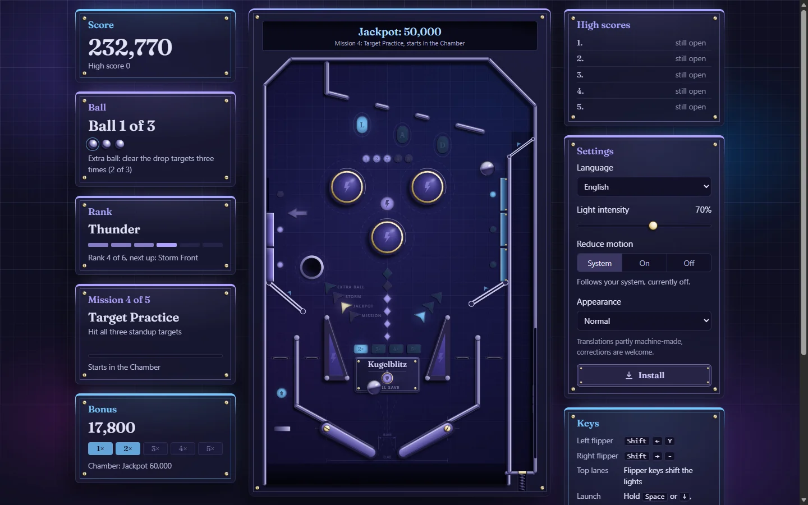
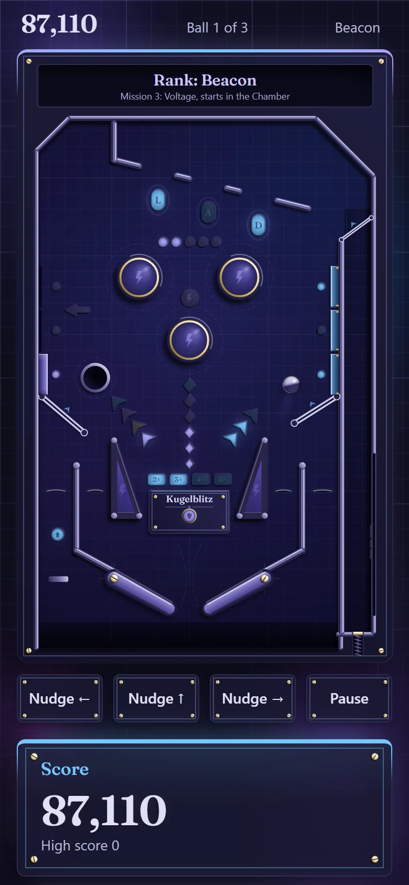
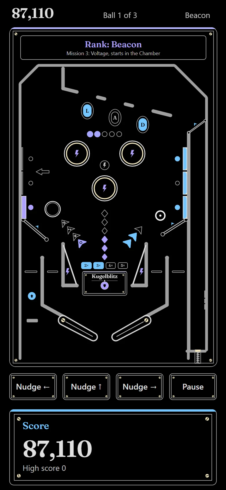

# Kugelblitz

**A pinball game in your browser, dark, silent and without a single flash.** Five missions, six ranks, a multiball with jackpots and a high score list, on physics that no ball slips through. Keys on the computer, fingers on the phone or tablet. It runs straight from the page, installs as an app and works offline after the first visit.

  

**Play:** https://dennismit2n.github.io/kugelblitz/ · [Deutsche Fassung](README.de.md)

## The table

A whole table on one screen: a plunger lane with skill shot, two flippers, two slingshots, inlanes and outlanes with a kickback on the left, the three top lanes L, A and D, three bumpers, a drop target bank on the left, three standup targets on the right and the Chamber, a hole in the middle that holds the ball for a second and then starts whatever is lit. Drawn in the style of my workshop: violet night, aurora, a blueprint grid and plates with white gold screws.

## Keys and touch

| | Keyboard | Touch |
|---|---|---|
| **Flippers** | left and right Shift, ← →, or `Z` and `/` (`Y` and `-` on a German keyboard) | tap the left or right half of the table |
| **Launch** | hold Space or ↓, release | hold the plunger lane or pull it down |
| **Nudge** | X, period, ↑ | buttons below the table |
| **Pause** | P or Esc | button below the table |
| **New game** | F2 any time, Enter before and after a game | tap the table |
| **Physics demo** | T switches the step size, B fires a test salvo | keys only |

The game shows the labels of your own keyboard. Enter also counts the bonus up at once.

## Rules in short

- **Three balls, five missions.** They come one after another across the whole game, with no time limit: *Build Charge* (hit the bumpers 15 times), *Conduits* (light all three top lanes), *Voltage* (clear the drop target bank twice), *Target Practice* (hit all three standups) and *Discharge* (send the ball into the Chamber three times). The first one starts with your first launch, every further one in the Chamber.
- **Six ranks.** Every mission takes you up a rank: Spark, Glimmer, Beacon, Thunder, Storm Front and finally Kugelblitz. A mission pays 25,000 points times the number of your rank.
- **Multiball “Thunderstorm”.** From rank Thunder the Chamber lights the storm. A second ball joins, and every visit to the Chamber pays the jackpot: 50,000, then 10,000 more each time.
- **And the rest of a real table:** a skill shot on the marked top lane (10,000), a bonus multiplier up to 5× from the top lanes (the flipper keys move the lit lanes), the kickback, a ball save for 8 seconds after each launch (12 in multiball), tilt with a warning first, an extra ball after the third cleared drop target bank and a top five with dates.

## The physics: nothing tunnels through

Kugelblitz runs on its own small physics, grown from Lesson 04 of Matthias Müller’s “Ten Minute Physics”. The lesson moves every ball once per frame. A fast ball can then jump over a thin flipper between two frames and simply pass through it. That is called tunneling, and it is the classic trap of browser pinball.

- **Substeps:** the physics runs at a fixed 120 ticks per second, and every tick is split so finely that no ball moves more than 40 % of its radius at once.
- **Time account:** the game runs equally fast on 60 Hz and 144 Hz screens, and the drawing interpolates between ticks so nothing stutters.
- **Safety net:** a speed cap, and a bounce only when the ball and the obstacle are actually moving toward each other.

You can watch the difference. Press **T** to switch to the step size of the lesson, then **B** (with no ball in play) to fire a test salvo at the left flipper: with the lesson’s steps fast balls slip through, with substeps none do. The panel “Physics and testing” counts along. The test script does the same on a large scale: of 144 balls per speed fired at the resting flipper, the original lesson lets 29 % through at speed 5 and 60 % at speed 9, Kugelblitz none.

## Light safety

Ball lightning without the lightning. WCAG 2.3.1 allows up to three flashes per second, Kugelblitz allows none. Lights fade softly in and out, there are at most three light events per second, nothing blinks in a rhythm, and numbers change at most every half second instead of counting up frame by frame. A slider sets the light intensity from 30 to 100 %, and “Reduce motion” turns off the ball trail and stops the aurora. There is no sound at all.

The L-Meter checks this in the browser. `index.html?licht=1` plays a script with every light event of the game and measures the relative luminance of every frame: the average may change by at most 0.02 from one frame to the next, and no area of the table may show a single general or red flash. `index.html?licht=frei&sek=150` measures free play, `index.html?licht=modi` the switch between appearances. The result appears on the page and in `window.lichtBericht`.

## Appearance, languages, app

- **Visual aids:** under “Appearance” you find the same choices as in the other tools of the workshop: high contrast dark and light (flat, without gradients or glow), color-blind (Okabe-Ito colors, outlines around lit lamps and signs on the Chamber ladder) and inverted colors. Normal always stays dark, the light versions are there only as an aid, and switching never flashes.
- **14 languages:** German, English, Spanish, French, Italian, Dutch, Polish, Portuguese, Turkish, Russian, Hindi, Chinese, Japanese and Korean, detected from your browser and changeable in the settings. Some translations are machine-made, corrections are very welcome.
- **App and offline:** after the first visit a service worker keeps Kugelblitz available without a connection. In Chrome, Edge and Samsung Internet an “Install” button appears in the settings and sets it up as an app in full screen. On an iPhone use “Add to Home Screen” in Safari. You can also download the files and double-click `index.html`; it plays without a server, only installing and offline need one.

## Privacy

- No account, no ads, no cookies, no tracking. The game sends nothing anywhere and loads nothing from other sites; even the font is in the repo. You can check it in the network tab of the developer tools.
- Your browser only keeps what you set yourself: language, light intensity, reduce motion, appearance and your high scores.

## Tests

No build step, no dependencies, no modules: `index.html` loads `sprachen.js`, `physik.js`, `regeln.js` and `grafik.js` as plain scripts, which is why a double-click works. The layers are strict: the physics reports events, the rules turn them into game state, the drawing only reads.

Three test scripts, run one after the other with Node.js (no packages needed). Each ends with “BESTANDEN” and exit code 0.

| Command | What it checks |
|---|---|
| `node tests/tunnel.mjs --pruefen` | Physics and tunneling: fires balls at flippers, walls, corners, slingshots, targets and the Chamber, runs the original lesson side by side, plays the table and checks that every part is reachable and nothing gets stuck. |
| `node tests/regeln.mjs` | Rules and languages: scoring, missions, ranks, multiball, bonus, tilt, ball save, high scores, and that every language has every text. |
| `node tests/spiel.mjs` | An autoplayer with a good and a weak profile plays 80 games each plus six long games and checks the balance: length of a game, share of balls lost in the outlanes, missions, multiball. |

## Tools

`werkzeuge/` holds three scripts that drive Microsoft Edge headless over the DevTools protocol. They expect Edge at its usual place on Windows and the game on a local server at port 8643, for example `python -m http.server 8643 --bind 127.0.0.1`. None of them is needed to play.

- `foto.mjs`: screenshots at 1440, 1024 and 390 pixels plus a check of keys and touch. `SPRACHE`, `MODUS`, `FORMAT=webp` and `BASIS` choose language, appearance, file format and address. The pictures in `docs/` come from it.
- `messen.mjs`: the L-Meter including the tiles around the table, and drawing times.
- `icons.mjs`: renders the PNG icons from the SVG templates in `icons/`.

## Credits and license

- The physics grew out of Lesson 04, “Pinball”, of [Ten Minute Physics](https://matthias-research.github.io/pages/tenMinutePhysics/) by Matthias Müller, under the MIT license. His file is in the repo unchanged as `lektion04-original.html`, and his notice stays in `LICENSE` and at the top of `physik.js`.
- The font is [Fraunces](https://github.com/undercasetype/Fraunces) by The Fraunces Project Authors, under the SIL Open Font License 1.1 (`schrift/OFL.txt`).
- The keys are inspired by the old Windows pinball “3D Pinball: Space Cadet”. No graphics, sounds or table layout from it or any other game are used; the table, the drawing and the rules are my own.

[MIT](LICENSE)

© 2026 Dennis_mit_2n · part of [the workshop](https://dennismit2n.github.io/)
